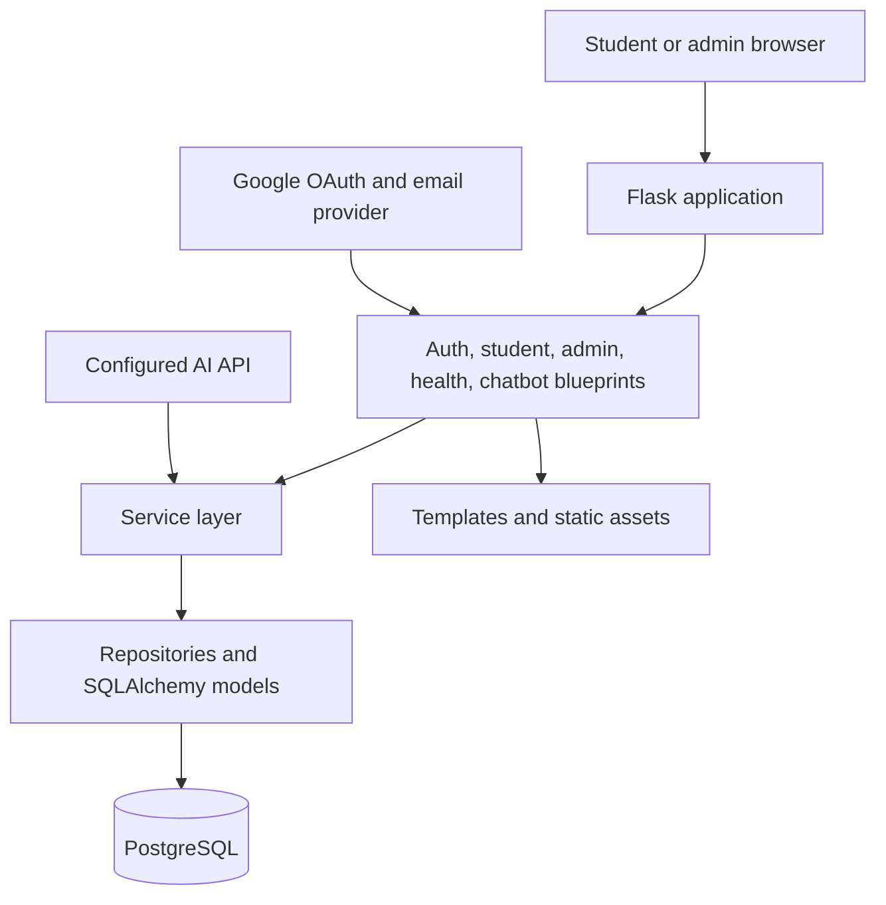

# Academic Governance System

A Flask and PostgreSQL platform for managing student academic services, complaints, labs, placements, and administration.

## Why this exists

Academic information and student support workflows are often split across separate tools. This project provides one role-aware portal for students and administrators, with authentication, academic records, complaint tracking, lab operations, placement workflows, and notifications backed by a relational database.

## Key features

- Email OTP authentication and optional Google OAuth sign-in.
- Student dashboards for attendance, marks, course materials, timetables, and progress.
- Complaint submission, status tracking, admin responses, attachments, and notifications.
- Lab system visibility and administrative status management.
- Placement drive, profile, and application workflows.
- Administrative tools for attendance, marks, materials, timetable, and student records.
- Configurable AI chatbot integration through an OpenRouter-compatible API endpoint.
- PostgreSQL persistence with Alembic/Flask-Migrate migrations and CI checks.

## Tech stack

- **Backend:** Python 3.11+, Flask, Flask-SQLAlchemy, Flask-WTF, Flask-Migrate
- **Database:** PostgreSQL 15, SQLAlchemy, psycopg
- **Authentication:** Email OTP and Authlib-based Google OAuth
- **Frontend:** Jinja2 templates, JavaScript, Tailwind CSS source/configuration, committed static assets
- **Operations:** Gunicorn, Docker, Docker Compose, optional Nginx reverse proxy
- **Quality:** pytest, Ruff, Bandit, pip-audit, GitHub Actions
- **Dependency management:** uv and npm

## Architecture



The application is created by `academic_governance.create_app()`. Routes are organized as Flask blueprints, business operations live in `academic_governance/services`, and database access is provided through SQLAlchemy models and repositories.

## Setup and run

### Local development

Requirements: Python 3.11+, PostgreSQL, and [uv](https://docs.astral.sh/uv/).

```bash
git clone https://github.com/dhanu-17-git/Academic-Governance-System.git
cd Academic-Governance-System
cp .env.example .env
```

Set at least `DATABASE_URL` and `SECRET_KEY` in `.env`. Add email, Google OAuth, AI, and Sentry values only when those integrations are needed. The configuration loads `.env` automatically.

```bash
uv sync
uv run flask --app wsgi:app db upgrade
uv run flask --app wsgi:app run
```

Open `http://127.0.0.1:5000`. The application expects PostgreSQL; it does not fall back to SQLite.

### Docker Compose

For the production-shaped Compose configuration, create the environment file expected by `docker-compose.yml`:

```bash
cp .env.production.example .env.production
# Replace the placeholder values in .env.production
docker compose up --build
```

The web container listens on port `5000`. To include the optional Nginx proxy profile:

```bash
docker compose --profile proxy up --build
```

The staging override uses `.env.staging`, port `5001` for the web service, and port `5433` for PostgreSQL:

```bash
cp .env.staging.example .env.staging
# Replace the placeholder values in .env.staging
docker compose -f docker-compose.yml -f docker-compose.staging.yml up --build
```

### Tests and checks

```bash
uv run pytest
uv run ruff check .
uv run bandit -r academic_governance/ --skip B101 -q
uv run pip-audit
```

The CI workflow excludes the live-provider tests in `tests/test_openai.py` and `tests/test_gemini_models.py`.

The repository includes Tailwind dependencies in `package.json` and `package-lock.json`; `package.json` currently defines no npm build or test scripts. The application serves the committed static assets directly.

## Project structure

```text
academic_governance/     Application package, routes, services, models, and repositories
deployment/              Nginx, Gunicorn, systemd, backup, and deployment Compose files
docs/                    Architecture, operations, deployment, and security documentation
migrations/              Flask-Migrate/Alembic configuration and revisions
scripts/                 Data seeding and integration utilities
static/                  CSS, JavaScript, and frontend assets
templates/               Jinja2 HTML templates
tests/                   Unit, route, integration, and startup tests
app.py                   Local Flask entry point
wsgi.py                  Gunicorn/WSGI entry point
pyproject.toml           Python project and tool configuration
```

## Screenshots

Screenshots are not currently included. Add them under `docs/images/` as the UI is documented:


## Roadmap

- Add a documented frontend build command if Tailwind assets become generated during development.
- Replace the screenshot placeholder with current, sanitized application screenshots.
- Separate optional live-provider checks from the default developer test command.
- Keep deployment and secret-rotation documentation aligned with the Compose files and environment variables.

## License

This project is released under the MIT License. See [LICENSE](LICENSE).
